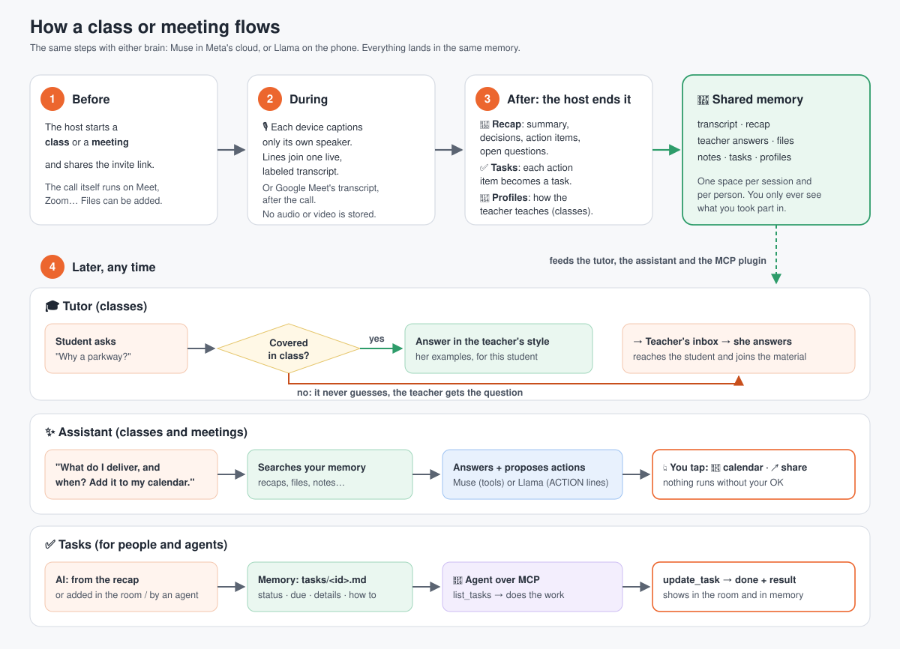
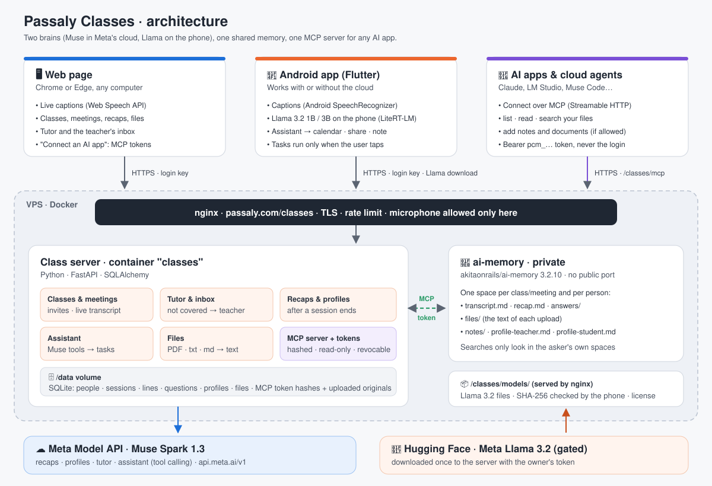

# Passaly Classes: what it does

**Live classes and meetings, a recap afterwards, and an AI assistant that
remembers them, running in Meta's cloud (Muse Spark) or entirely on the phone
(Llama 3.2).**

Built for a hackathon. The story behind it: Siena, 10, is a Canadian girl
living in Brazil. Her teacher, Giovanna, is in Canada, 11,000 km away. They
meet over a video call, but class time is short and questions come later,
when the teacher is asleep. Passaly Classes turns every class into a
personal tutor that teaches the way Giovanna teaches, and sends Giovanna only
the questions her class did not answer.

The same idea works for meetings: everyone leaves with a recap, decisions and
action items, and an assistant that can answer "what did we decide?" weeks
later.

---

## What happens, step by step

### 1. Before: start a class or a meeting
The teacher (or meeting host) creates a **class** or a **meeting** in the app
or on the web page and shares the invite link. The call itself happens on any
app (Meet, Zoom…); Passaly Classes never records audio or video.

### 2. During: live captions become the transcript
Each person's own phone or browser listens to **its own speaker only** and
turns their voice into text. Every line goes to the server labeled with who
said it, so everyone sees one shared, live transcript.

**Or let Google Meet do it.** Sign in with Google and a new meeting gets a
Google Meet link with Meet's transcript turned on. Nobody needs our page open
during the call: when the meeting ends, Meet's transcript (who said what)
comes back here by itself and the recap follows. Only what was said in the
meeting comes in. This needs a Google Workspace plan that has Meet
transcripts.

### 3. After: the recap and the profiles
When the host ends it, the AI writes:

- **A recap**: summary, decisions, action items (who, what, by when), open
  questions. It uses only what was said and never invents owners or dates.
- **Profiles** (classes): how this teacher explains things, and how each
  student learns. They get better with every class.

### 4. Later: the tutor (classes)
The student asks a question about the class.
- **Covered in class** → the tutor answers the way the teacher did, with her
  examples, adapted to the student.
- **Not covered** → the tutor does not guess. The question goes to the
  teacher's inbox. Her answer reaches the student **and joins that class's
  material**, so the next student gets it straight away.

### 5. Anytime: the assistant (classes and meetings)
"What do I have to deliver, and when? Put it in my calendar."

The assistant searches everything the person took part in, answers from it,
and proposes **tasks**:

| Task | What happens |
|---|---|
| Add a calendar event | Opens the phone's calendar with the event filled in |
| Share text | Opens the share sheet (email, WhatsApp…) with the recap |
| Save a note | Saves it to the person's memory |
| Add a task | Adds it to the class's or meeting's task list (or a personal one) |

Calendar and share wait for the user's tap, and the calendar still asks for
confirmation. Notes and tasks are saved straight away.

### 6. Tasks: for people and for agents
"Add a task in this meeting: translate the FAQ to Portuguese by Monday."

A task can be added three ways: the **Add task** button in the room, asking
the assistant, or an AI agent over MCP. Everyone in the class or meeting sees
it; a personal task is only yours.

Every task is also a page in that meeting's memory, `tasks/<id>.md`, with
its status, who added it, the due date, the details and how to update it.
An agent connected over MCP reads it, does the work, and reports back:
`list_tasks` → `update_task` (in progress → done, with a result). The result
shows up in the room and in the memory page. Read-only tokens can see tasks
but not change them.

---

## Two brains, one memory

- **Muse Spark** (Meta's cloud model, through the Meta Model API) writes the
  recaps and profiles, answers in the browser, and runs the assistant's tasks
  through tool calling.
- **Llama 3.2 1B or 3B** (Meta's open model, through Google's LiteRT-LM) runs
  **inside the phone**: no cloud AI sees the questions. After class the tutor
  also works **without internet**: the phone keeps each class's material, and
  questions wait on the phone until it is back online (then the teacher gets
  the ones the class didn't cover). The phone writes the recap and the
  profiles itself, and proposes the same tasks.
- **ai-memory** ([akitaonrails/ai-memory](https://github.com/akitaonrails/ai-memory))
  keeps the shared memory, so switching brains changes who thinks, not what
  is remembered.
- **The plugin**: `https://passaly.com/classes/mcp` is an MCP server that
  hosts *your* files: recaps, transcripts, answers, the documents added to
  your classes and meetings, notes. Any AI app or cloud agent that supports
  MCP (Claude, LM Studio, Muse Code…) can list, read, search and add to them, and pick up and finish tasks,
  and only yours. Each app gets its own **MCP token**: shown once,
  read-only unless you allow writing, revocable, expiring after 90 days.

### Tested for real
- A two-person **Google Meet** meeting: Meet's transcript came back by itself,
  speaker by speaker, and Muse wrote the recap.
- **Two agents, one memory**: Meta's Muse Code wrote a plan into a meeting and
  closed its task; Claude Code then found that plan in the same memory; the
  meeting page showed both.

### Files in a class or meeting
Anyone in it can add a PDF, .txt or .md. Everyone in it can read it, and the
assistant and connected AI apps use it to answer.

In the app, the choice is one switch: **This phone · Llama** or
**Meta cloud · Muse**.

---

## Privacy and safety

- **No audio or video is stored**, only the text of what was said.
- **You only see what you took part in.** Memory is kept per class or
  meeting and per person. A search, in the app or through the plugin, only
  looks at your own spaces.
- **On-device mode**: with Llama, the AI runs on the phone, so no cloud AI
  sees the student's questions. They are still saved on the class server, so
  the teacher can see them and answer what the class didn't cover.
- **The tutor doesn't guess.** Anything the class didn't cover goes to a
  human, the teacher.
- **Calendar and share need a tap**, and calendar events are confirmed in the calendar app.
- **Agents only change tasks with a write token**; read-only tokens can just look.
- **AI apps use their own tokens**, never your login: stored only as a hash,
  read-only by default, revocable and expiring.
- **Llama 3.2** is used under Meta's Llama 3.2 Community License; the app
  shows "Built with Llama" and the license.

---

## What's in this repository

| Part | What it is |
|---|---|
| `app.py`, `models.py`, `memory.py` | The server (Python, FastAPI, SQLite): classes, transcript, questions, recaps, the assistant, tasks, the MCP plugin |
| `static/index.html` | The web page: classes and meetings in the browser, with live captions (Chrome or Edge) |
| `app/` | The Android app (Flutter): captions, the tutor, the assistant, Llama on the phone |
| `test_app.py`, `app/test/` | Checks for the whole flow |
| `README.md` | How to run, build and deploy it, the API and the MCP server |
| `docs/` | The diagrams |
| `deploy/` | The server's scripts, nginx block and example settings files (no keys) |

## Limits today

- **Android only** for the app. The web page works on any computer with
  Chrome or Edge.
- **Llama on the phone is weaker at the assistant's actions** than Muse. Use the 3B model for
  the assistant.
- **Llama on the phone is not reliable yet.** In our last test it repeated
  its instructions instead of answering, while Muse in the cloud answered the
  same question from the class. Fixing that is the first job after the
  hackathon.
- **A Google Meet class takes its words from Meet only**; to type lines,
  create the class without the Meet option.
- **Memory search matches words.** When nothing matches, the assistant reads
  your latest recaps instead.
- **Accounts are a name and a key**, or a Google sign-in, for the demo. The plan is to move it into
  Passaly, with real logins, after the hackathon.
