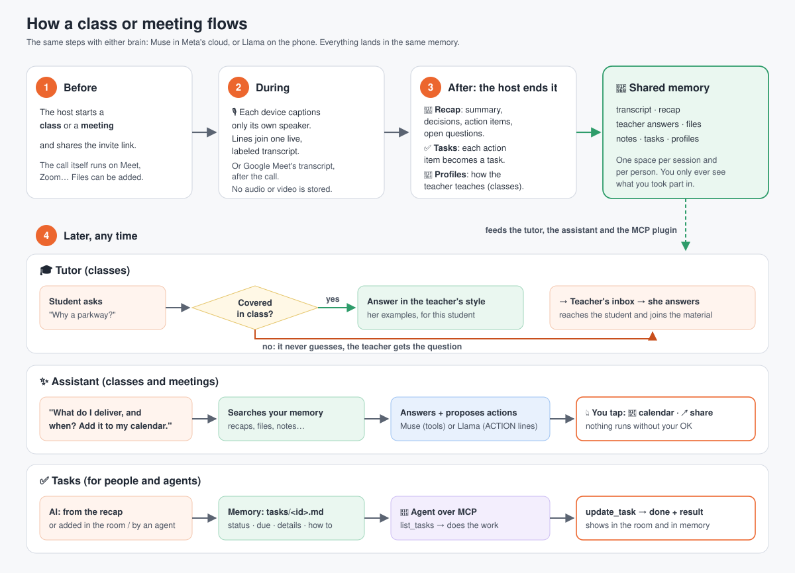
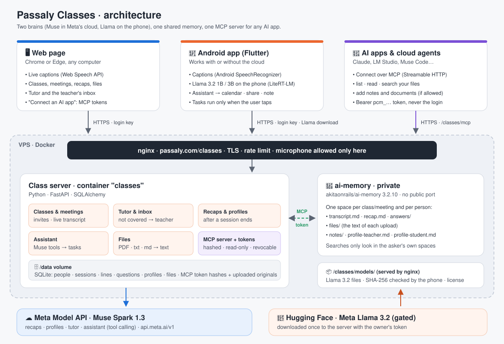

# Passaly Classes

**Live classes and meetings → a recap → a tutor and an assistant that remember
them.** The AI runs in Meta's cloud (Muse Spark) or entirely on the phone
(Llama 3.2), sharing one memory. Any AI app can read that memory through an
MCP server.

Built for a hackathon. **[ABOUT.md](ABOUT.md)** explains it in plain words;
this file is for building and running it. Live at **https://passaly.com/classes**.

---

## Architecture

| Part | What it is | Where |
|---|---|---|
| Web page | Classes and meetings in the browser, live captions (Web Speech API), files, MCP tokens | `static/index.html` |
| Android app | Captions (SpeechRecognizer), tutor, assistant with tasks, Llama 3.2 on the phone (LiteRT-LM), files, MCP tokens | `app/` (Flutter) |
| Class server | Classes, transcript, tutor and teacher inbox, recaps, profiles, assistant, files, MCP server and tokens | `app.py`, `models.py` (FastAPI, SQLAlchemy, SQLite) |
| Shared memory | One space per class/meeting and per person: transcripts, recaps, answers, file text, notes, profiles | `memory.py` → [ai-memory](https://github.com/akitaonrails/ai-memory) |
| Cloud brain | Recaps, profiles, tutor, assistant (tool calling) | Meta Model API, `muse-spark-1.3` |
| Phone brain | The same jobs, on the device | Llama 3.2 1B / 3B (`models/index.json`) |

---

## Run it locally

    python3 -m venv .venv && .venv/bin/pip install -r requirements.txt
    .venv/bin/uvicorn app:app --reload --port 8010      # http://localhost:8010
    .venv/bin/python test_app.py                         # the whole flow, fake AI

Live captions need Chrome or Edge; other browsers can type lines. With no
settings at all it runs without cloud AI and without shared memory: classes,
captions, the inbox and files all work, and the phone app does the AI.

| Setting | Default | What for |
|---|---|---|
| `TUTOR_API_KEY` | none (no cloud AI) | Key for any OpenAI-compatible API: Meta Model API for Muse |
| `TUTOR_BASE_URL` | OpenAI | `https://api.meta.ai/v1` for Muse |
| `TUTOR_MODEL` | `gpt-4o-mini` | `muse-spark-1.3` |
| `AI_MEMORY_URL` | none (memory off) | ai-memory server, e.g. `http://ai-memory:49374` |
| `AI_MEMORY_AUTH_TOKEN` | none | its bearer token |
| `AI_MEMORY_WORKSPACE` | `passaly-classes` | ai-memory workspace name |
| `DATABASE_URL` | `sqlite+aiosqlite:///classes.db` | the database |
| `FILES_DIR` | `./files` | uploaded originals |
| `MODELS_DIR` | `./models` | Llama files, when this server serves them itself |
| `MCP_ALLOWED_ORIGINS` | `https://passaly.com` | browser origins allowed on `/mcp` |

Using Muse: the Meta Model API is OpenAI-compatible
([docs](https://dev.meta.ai/docs/overview)), so the three `TUTOR_` settings are
all it takes. Muse is sent no `temperature`; Meta says it is tuned for the default
([docs](https://dev.meta.ai/docs/protocols/chat-completions)).

---

## The live deployment (VPS)

Two containers on the VPS's Docker network `answer-net`, behind its nginx:

| Container | Image | Exposed |
|---|---|---|
| `classes` | built from this repo's `Dockerfile` | through nginx at `/classes/` only |
| `ai-memory` | `akitaonrails/ai-memory:3.2.10` | nothing: the Docker network only |

On the server, `~/class_tutor` holds the code and three private files (mode
600, never in git): `meta.env` (Muse settings and key), `aimem.env`
(ai-memory's token), `classes-mem.env` (address and token for the class
server), and `google.env` (Google sign-in client, optional). Data lives in the volumes `classes_data` (SQLite and uploads) and
`ai-memory-data`.

Redeploy after a change:

    rsync -a --exclude .venv --exclude app --exclude .git --exclude files \
      --exclude '*.db' --exclude '*.env' ./ ubuntu@<vps>:class_tutor/
    ssh ubuntu@<vps> 'cd ~/class_tutor && docker build -q -t class-tutor . && ~/run-classes.sh'

Helper scripts in the server's home folder:

- `./set-meta-key.sh` asks for the Meta Model API key (hidden), tests it with
  one tiny request, saves it in `meta.env` and restarts `classes`.
- `./run-classes.sh` (from `deploy/`) restarts `classes` with every settings
  file that exists.
- `./set-google.sh` (from `deploy/`) asks for the Google OAuth client ID and
  secret (hidden), saves them in `google.env` and restarts `classes`.
- `./fetch-llama.sh` asks for a Hugging Face token (hidden; Meta's license
  must be accepted on the model pages first), downloads both Llama files to
  `/classes/models/`, and keeps a file only if its SHA-256 matches `index.json`.

nginx: `/classes/` proxies to `classes:8010` (resolved per request, so nginx
still starts if the container is down), with its own `Permissions-Policy`
that allows the microphone for captions; `/classes/models/` is served from
disk.

---

## The phone app (Android)

    cd app
    flutter test
    flutter build apk --release          # build/app/outputs/flutter-apk/app-release.apk

On first start the app asks for a name and the class server, which is already
filled in with `passaly.com/classes`. A domain is reached over HTTPS and an IP
like `192.168.1.76:8010` over plain HTTP, for a laptop on the same Wi-Fi.

**Offline after class**: with Llama, the phone keeps each class's material
(the last answer of every read is cached) and queues questions with no
connection, sending them in order once the server answers again.

**Tutor AI** (chip icon): choose **This phone · Llama** or **Meta cloud · Muse**,
and download Llama: the 1B (~0.96 GB) or the 3B (~2.2 GB, better at tasks). The
app checks each file against the SHA-256 in `models/index.json` and greys out
models the phone's RAM cannot hold.

Running the server on a laptop for the phones (WSL 2)

Start it with `--host 0.0.0.0`. WSL 2 is not reachable from the Wi-Fi by
default ([Microsoft docs](https://learn.microsoft.com/en-us/windows/wsl/networking)).
In an admin PowerShell (redo the first line after a reboot):

    netsh interface portproxy add v4tov4 listenport=8010 listenaddress=0.0.0.0 connectport=8010 connectaddress=$(wsl hostname -I).Trim()
    New-NetFirewallRule -DisplayName "Passaly Classes 8010" -Direction Inbound -Protocol TCP -LocalPort 8010 -Action Allow

Put the Llama files and `LICENSE.txt` / `NOTICE.txt` in `models/`.

---

## How the pieces work

**Classes and meetings.** A session is a `class` or a `meeting`. In a
meeting, teacher/student read as host/participant. Each device posts only
its own speaker's caption lines.

**After it ends.** With Muse, the server writes the recap (summary, decisions,
action items, open questions) and the profiles, then saves the transcript and
recap to memory. With Llama, the host's phone writes the recap and sends it
(`PUT /api/classes/{id}/recap`), and each phone writes its own profile.

**Tutor.** A student's question is answered only from the class's transcript
and the teacher's later answers. If they don't cover it, the question goes to
the teacher's inbox, and her answer joins the class material.

**Assistant.** It answers from the shared memory and proposes tasks:
`add_calendar_event`, `share_text`, `save_note`.
- Muse: `POST /api/assistant`, with Meta's tool calling ([docs](https://dev.meta.ai/docs/tool-calling)).
- Llama: the phone reads `GET /api/memory/search` and writes `ACTION {...}` lines.

Both paths check the arguments the same way. Calendar and share open the
phone's own app, filled in ([Android intents](https://developer.android.com/guide/components/intents-common#AddEvent)),
and run only when the user taps.

**Files.** Anyone in a session can add a PDF, .txt or .md (10 MB). The
original is kept for download; its text (`pypdf` for PDFs) goes into the
session's memory, so the assistant and MCP can use it.

**Tasks.** A task directory per class or meeting (everyone in it sees it), or
a personal one. Add a task from the room ("Add task"), by asking the assistant
("add a task in the meeting: …"; Muse calls `add_task`, Llama writes an
`ACTION {"type":"add_task",…}` line), or from an agent over MCP. Each task is
mirrored to memory as `tasks/<id>.md` (status, who, due, details, result, and
how to update it), rewritten on every change, so agents find it with
`list_files` / `search_memory` too. An agent works through `list_tasks`, then
`update_task` (in_progress → done, with a `result`); the room shows the result.

**Google sign-in and Meet transcripts.** "Sign in with Google" asks once for
`openid email profile` and `meetings.space.created`. With it, starting a
meeting can create a Google Meet link whose transcript turns on by itself
when the host joins (`autoTranscriptionGeneration: ON`). After the meeting
the server reads Meet's transcript, speaker by speaker, into the session's
lines, then writes the recap, tasks and memory as usual. It checks every
minute for up to 30 minutes, since Meet finishes the transcript after
everyone leaves; the host can also press "Fetch Meet transcript". Only what
was said in the meeting comes in. Needs:
- a Google Workspace plan with Meet transcripts for the host (Business
  Standard or higher, Workspace Individual, Education Plus…; [editions](https://support.google.com/meet/answer/12849897));
- a Google Cloud project with the Google Meet REST API enabled, an OAuth
  consent screen (External, Testing, with the testers as test users) and a
  Web client whose redirect URI is `https://passaly.com/classes/api/google/callback`
  ([consent screen](https://developers.google.com/workspace/guides/configure-oauth-consent),
  [client](https://developers.google.com/workspace/guides/create-credentials)).
  In Testing, a sign-in lasts 7 days, then sign in again. Add
  `https://www.googleapis.com/auth/meetings.space.created` under Google Auth
  platform → Data Access too: without it Google left the Meet box off the
  consent screen and the app got name and email only;
- the meeting created here, with the option ticked: a Meet link pasted into
  the call field cannot be read, because the permission covers only the Meet
  spaces this app created.

Meet marks a transcript `ENDED` before its text is there, so the import waits
for `FILE_GENERATED`. Tested 2026-11-04 with a real two-person meeting: Meet's
transcript (Portuguese and English, both speakers) came back as the lines and
Muse wrote the recap in the meeting's language.

Docs: [OpenID Connect](https://developers.google.com/identity/openid-connect/openid-connect),
[Meet spaces](https://developers.google.com/workspace/meet/api/reference/rest/v2/spaces),
[Meet transcripts](https://developers.google.com/workspace/meet/api/guides/artifacts).

**Memory.** [ai-memory](https://github.com/akitaonrails/ai-memory) over its
MCP endpoint (`memory_write_page`, `memory_query`, `memory_read_page`,
`memory_recent`). Spaces are `session-<id>` and `person-<id>`; a search only
covers the asker's own spaces. A search with no keyword match falls back to
the newest recaps.

---

## The MCP server

`https://passaly.com/classes/mcp` speaks MCP over Streamable HTTP with JSON
responses ([spec](https://modelcontextprotocol.io/specification/2025-06-18/basic/transports)).
It hosts each person's files and nothing of anyone else's.

| Tool | Does | Needs write |
|---|---|---|
| `list_files` | Every file you can read, optionally for one class or meeting, as `passaly://` URIs | |
| `read_file` | One file in full | |
| `search_memory` | Keyword search over all of it | |
| `save_note` | A note in your own memory | ✔ |
| `list_tasks` | Tasks you can see (filter by `status`, `session_id`) | |
| `add_task` | A task in one of your classes or meetings, or your own | ✔ |
| `update_task` | Status (`open`, `in_progress`, `done`) and a `result` | ✔ |
| `add_document` | A markdown document in one of your classes or meetings | ✔ |

The same files are MCP **resources** (`resources/list`, `resources/read`;
[spec](https://modelcontextprotocol.io/specification/2025-06-18/server/resources)).

**Tokens.** Create one per AI app in the web page ("Connect an AI app") or
the app (menu → Connect an AI app). A token:

- is separate from the login key, which `/mcp` refuses;
- is shown once and stored only as its SHA-256;
- is read-only unless writing was allowed (read-only tokens don't even list
  the write tools);
- can be revoked at any time, and expires after 90 days (10 per person).

Client config, e.g.:

    {"mcpServers": {"passaly": {"url": "https://passaly.com/classes/mcp",
      "headers": {"Authorization": "Bearer pcm_<your token>"}}}}

Any MCP-capable agent shares the same memory. For example:

    # Claude Code (docs: code.claude.com/docs/en/mcp)
    claude mcp add --transport http passaly https://passaly.com/classes/mcp \
      --header "Authorization: Bearer pcm_<your token>"

    // OpenCode, opencode.json (docs: opencode.ai/docs/mcp-servers)
    {"mcp": {"passaly": {"type": "remote", "url": "https://passaly.com/classes/mcp",
      "headers": {"Authorization": "Bearer pcm_<your token>"}, "oauth": false}}}

    // Muse Code, ~/.config/muse/settings.json (docs: dev.meta.ai/docs/muse-code/extending)
    {"schema_version": 1,
     "mcp_servers": {"passaly": {"transport": "streamable_http",
       "url": "https://passaly.com/classes/mcp",
       "headers": {"Authorization": "Bearer pcm_<your token>"}, "mode": "optional"}}}

Muse Code needs `"schema_version": 1` and the key `mcp_servers` (not
`mcpServers`). On Windows, save the file without a byte-order mark: a file
written by PowerShell starts with one, and Muse Code then reports a malformed
settings file. Restart it and type `/mcp` to see the tools.

**Tested with two agents on one memory** (2026-11-04): Muse Code read a
meeting's tasks, wrote a plan with `add_document` and closed the task with
`update_task`; Claude Code, connected with its own config, found that plan
with `search_memory` and read it; the meeting page showed the document in
Files and the task done with Muse Code's result.

For a Claude custom connector, put the header under *Request headers*
([Claude help](https://support.claude.com/en/articles/11175166-get-started-with-custom-connectors-using-remote-mcp)).

---

## API

All `/api` calls send `X-Person-Key` (from `POST /api/people`, or from
signing in with Google).
`/mcp` takes an MCP token instead.

| Method | Path | What |
|---|---|---|
| POST | `/api/people` | Sign in with a name → key |
| GET | `/api/google/start` · `/api/google/callback` | Sign in with Google → key (in the URL fragment) |
| GET | `/api/me` | Who I am; signed in with Google; can create Meet links |
| POST · GET | `/api/classes` | Start a class or meeting · my sessions |
| POST | `/api/classes/join/{token}` | Join with an invite |
| GET | `/api/classes/{id}` | One session, its people and recap |
| POST · GET | `/api/classes/{id}/lines` | Add a caption line · new lines since `after` |
| POST | `/api/classes/{id}/end` | End it (host); starts recap and profiles (a Meet meeting first waits for Meet's transcript) |
| POST | `/api/classes/{id}/meet-transcript` | Fetch Meet's transcript now (host) |
| PUT | `/api/classes/{id}/recap` | Recap written on the host's phone |
| POST | `/api/classes/{id}/ask` | Tutor question, answered by Muse |
| POST · GET | `/api/classes/{id}/questions` | A question the phone answered · questions |
| GET | `/api/classes/inbox/waiting` | The teacher's inbox |
| POST | `/api/classes/questions/{id}/answer` | The teacher answers |
| GET | `/api/classes/{id}/pack` | Everything the phone's tutor needs |
| PUT | `/api/profiles/{kind}` | A profile written on the phone |
| POST · GET | `/api/classes/{id}/files` | Upload (raw body, `?name=`) · list |
| GET | `/api/classes/{id}/files/{fid}` | Download the original |
| GET | `/api/memory/search?q=` | Memory pages for the phone's assistant |
| POST | `/api/memory/notes` | Save a note |
| POST | `/api/assistant` | Assistant with Muse: reply + proposed tasks |
| POST · GET | `/api/tasks` | Add a task · tasks I can see (`?status=`, `?session_id=`) |
| PATCH | `/api/tasks/{id}` | Change status, record a result |
| GET | `/api/tutor` | Is a cloud model set up? Which? Is Google sign-in on? |
| POST · GET · DELETE | `/api/mcp/tokens` | Create · list · revoke MCP tokens |
| POST | `/mcp` | The MCP server |

---

## Tests

    .venv/bin/python test_app.py     # server: the class flow, meetings, recaps, memory
                                     # privacy, assistant tools, files (a real PDF),
                                     # MCP and its tokens, the SQLite lock regression
    cd app && flutter test           # app: retrieval, replies, ACTION parsing, time zones

## Known issues

- **Llama on the phone can loop.** In a test on 2026-11-04 the 3B model
  repeated the tutor prompt instead of answering, and the 1B one echoed the
  question before answering. The app now asks for a short answer and trims
  echoed labels, questions and repeats, but the model running on until the
  output cap is not fixed; Muse in the cloud answered the same question well.
  Likely culprit: how the prompt reaches LiteRT-LM's conversation (chat
  template and stop tokens).
- **A Google Meet class has no typing box**: its lines come from Meet's
  transcript only. Make the class without the Meet option to type lines.
- **The MCP server has no rate limit of its own**; tokens protect the data,
  not the server's capacity. A `limit_req` zone in nginx is the next step.
- **Google Meet** needs a Workspace plan with transcripts for the host, and
  the Meet permission needs Google's review before people outside the test
  users can use it.

## Built with Llama

Llama 3.2 is licensed under the Llama 3.2 Community License, Copyright © Meta
Platforms, Inc. All Rights Reserved. The app shows this, and the license text,
on its "Tutor AI" screen.

## License

The code in this repository is open source under the [MIT License](LICENSE).
That covers our code only: Llama 3.2 stays under Meta's Llama 3.2 Community
License (above), and ai-memory under [its own](https://github.com/akitaonrails/ai-memory).

## Moving into Passaly later

Same stack and style as quiz-api (FastAPI, SQLAlchemy async, one router).
Move the router and the tables into quiz-api, swap `get_person` for
`auth.get_current_user`, drop the `Person` table, and point `DATABASE_URL`
at Postgres. The page becomes a React route.
